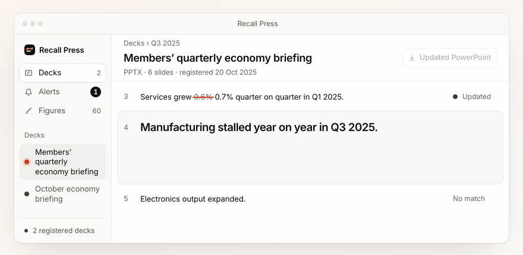
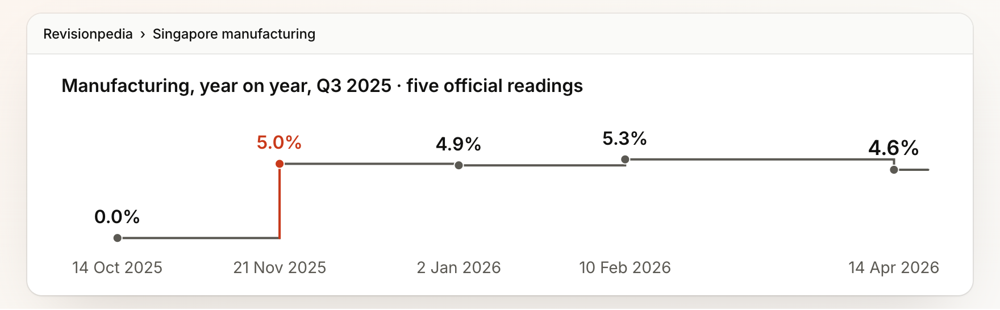
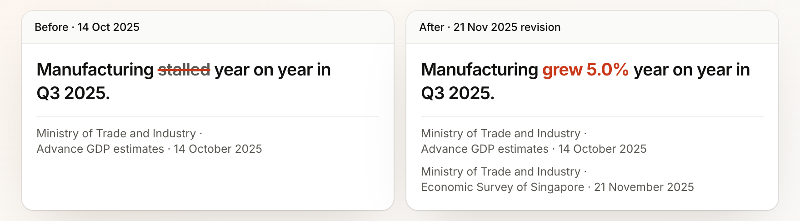
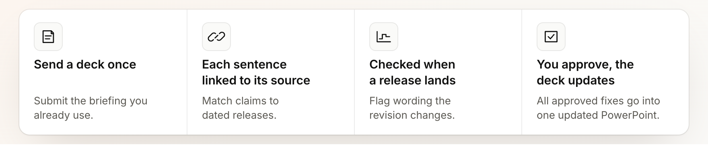
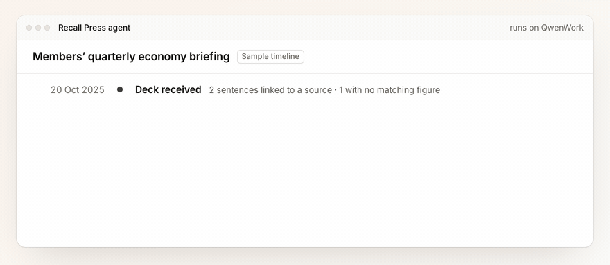

<div align="center">
  <picture>
    <source media="(prefers-color-scheme: dark)" srcset="docs/media/brand/lockup-dark.svg">
    
  </picture>

  <h1>Your sources change. Your deck updates itself.</h1>

  <p>For teams that publish economic briefings. When an official figure your deck cites is revised, Recall Press rewrites the sentence it broke.<br>
  You approve, and get the updated, editable PowerPoint with its dated source.</p>

  <p>
    <picture>
      <source media="(prefers-color-scheme: dark)" srcset="docs/media/hero-dark.gif">
      
    </picture>
    <br><sub>Q3 2025 manufacturing was first reported at 0.0%, revised to 5.0%, and now stands at 4.6%. Slide 4 is rewritten when you approve.</sub>
  </p>

  <p>
    <a href="https://revisionpedia.geo.hashmeta.tech/cover-my-briefing/">Send a deck</a> ·
    <a href="https://revisionpedia.geo.hashmeta.tech">Live site</a> ·
    <a href="https://ka62nv48.qwenwork.page/">Download the updated PowerPoint</a> ·
    <a href="https://vtzcv3g2.qwenwork.page/">Pitch slides</a> ·
    <a href="DEMO.md#watch">Demo film</a>
  </p>

  <p>
    <a href="https://github.com/Collaboration95/qw-hk/actions/workflows/ci.yml"></a>
    <a href="#built-with-qwenwork-and-hashmeta"></a>
    <a href="data/SOURCES.md"></a>
    <a href="#quickstart"></a>
  </p>
</div>

## The problem

**57 of the 60** Singapore figures we track were revised after first publication. In **18**, the revision changed the words a briefing would use (“stalled” became “grew”).

[Revisionpedia](https://revisionpedia.geo.hashmeta.tech), the free public record behind Recall Press, is live on Hashmeta with every release of every figure.

<p align="center">
  <a href="https://revisionpedia.geo.hashmeta.tech/revisions/sg-gdp-manufacturing-yoy-2025-q3/">
    <picture>
      <source media="(prefers-color-scheme: dark)" srcset="docs/media/figure-history-dark.png">
      
    </picture>
  </a>
</p>

## One revision, two answers

The **November 2025 revision** put Q3 manufacturing growth at **5.0%** year on year. The October release had put it at 0.0%. [MTI, Economic Survey of Singapore, 21 Nov 2025](https://www.singstat.gov.sg/files/a84a38d1-e0d8-4db9-bcf0-e95696170755.pdf)

| Sentence | Verdict on 21 Nov 2025 | What Recall Press does |
| --- | --- | --- |
| **Members’ briefing, slide 4**<br>“Manufacturing stalled year on year in Q3 2025.” | **Now wrong.** It describes growth in the quarter. | Proposes “Manufacturing grew 5.0% year on year in Q3 2025” and adds the November source. |
| **Board paper**<br>“As first reported in the October advance estimate, manufacturing output was flat year on year in Q3 2025.” | **Still true.** It describes the October estimate. | Leaves the sentence as written. |

<p align="center">
  <picture>
    <source media="(prefers-color-scheme: dark)" srcset="docs/media/before-after-dark.png">
    
  </picture>
  <br><sub>Reformatted slide excerpts. The October source stays, and the November source appears beneath it.</sub>
</p>

## How it works

<p align="center">
  <picture>
    <source media="(prefers-color-scheme: dark)" srcset="docs/media/how-it-works-dark.png">
    
  </picture>
</p>

<p align="center">
  <picture>
    <source media="(prefers-color-scheme: dark)" srcset="docs/media/run-dark.gif">
    
  </picture>
</p>

## Proof

| Measure | Result | Evidence |
| --- | --- | --- |
| Singapore figures tracked | **60** | [Revisionpedia](https://revisionpedia.geo.hashmeta.tech/revisions) |
| Revised after first publication | **57** | [Revision dataset](site/collections/revisions.json) |
| Revisions that change the wording | **18** | [Revision dataset](site/collections/revisions.json) |
| Verdict accuracy | Independent deck with 8 claims: the first blind read registered 7 and got 5 verdicts right. After two rule fixes, the engine registered all 8 from that same reading and got all 8 right. | [Run evidence](docs/qw-results/RESULTS.md) |
| Automated tests | **132** | [CI run](https://github.com/Collaboration95/qw-hk/actions/runs/45041016295) |

## Built with QwenWork and Hashmeta

| Component | What it does | Evidence |
| --- | --- | --- |
| QwenWork Skill | Reads briefings, links claims and drafts corrections. | [Skill](skills/recall-press/SKILL.md) |
| QwenWork Desktop | Runs checks against official figures. | [Live check](docs/qw-results/clock-1.md) |
| QwenWork Page | Hosts the review page and the updated PowerPoint download. | [Review page](https://j3jvce39.qwenwork.page/) · [Download](https://ka62nv48.qwenwork.page/) |
| Hashmeta | Publishes the 77-page Revisionpedia site and hosts the briefing submission form. | [Publication checks](docs/HASHMETA-LOG.md#22-nov-2026--v3-product-redesign-live) |

## What is real

- The editor approves every change.
- The founder wrote the sample briefings and board paper. The figures, dates and sources are official. The animations illustrate how the review works.
- Checks are meant to run when a release lands. In testing, QwenWork started one scheduled check and found no new revision. The checks that produced corrections were started by hand.
- No paying customer yet.

[Run logs and verification details](docs/EVIDENCE.md)

## Quickstart

From a clean checkout with Python 3.10 or later:

```sh
python3 -m venv .venv
. .venv/bin/activate
pip install -r requirements-dev.txt
./demo.sh
python -m pytest -q
```

**Two-minute walkthrough.** The demo runs offline and prints the output paths. Open the review page for **2025-11-21**, select the members’ briefing and download the updated PowerPoint. Then open the board paper to see the dated claim left as written. [Full demo guide](DEMO.md) · [Review page controls](web/README.md)

## Repo map

```text
recallpress/          Claim matching, revision checks and document export
skills/recall-press/  QwenWork Skill
site/                 Revisionpedia data and pages
web/                  Review pages and dated examples
samples/              Sample publications and briefing decks
tests/                Engine, document and integration tests
```

## Built for the QwenWork × Hashmeta hackathon

Built solo by an independent founder in Singapore for Track 1, Business Operations & Automation, at the One-Person Company Hackathon.

## Sources and licences

SingStat data accessed through data.gov.sg is used under the Singapore Open Data Licence v1.0. Dated MTI, METI, SingStat and MOM releases have their own reuse terms. [Dataset IDs, release links and terms](data/SOURCES.md)

PowerPoint exports use the MIT-licensed [python-pptx](https://pypi.org/project/python-pptx/) library. [Full library details](docs/EVIDENCE.md#source-and-library-details)
