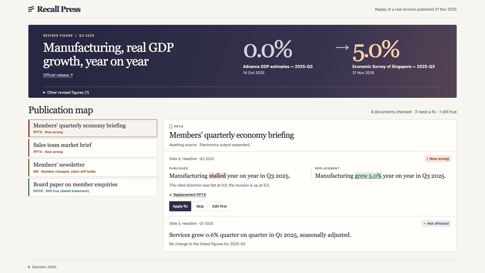

# Recall Press

**A slide that comes with its next correction.**

When agents turn one statistic into dozens of documents, published facts need a recall address. An editor registers a slide once. When the official figure changes, the map brings the editor back to the exact sentence with a source and an editable replacement.

**See it in 60 seconds.** Run `./demo.sh` from this checkout. Open the first map it prints, select the sample members’ briefing and download the corrected deck. On slide four, “Manufacturing stalled year on year in Q3 2025” becomes “Manufacturing grew 5.0% year on year in Q3 2025.” The October estimate was flat. The 21 November survey changed the headline.

[Open the saved map locally](web/examples/replays/2025-11-21.html) · [Inspect the dated sources](data/SOURCES.md) · [Browse Revisionpedia locally](site/preview/index.html)

## What the editor receives

The 14 October 2025 manufacturing estimate was 0.0%, the November survey said 5.0%, and a later release put the same quarter at 4.6%. A board paper reporting *what October’s estimate said* is still true. For Q2 2026 GDP, 5.7% became 5.9% and then 6.2%. A sentence saying growth stayed below 6% first needs a new number, then a new conclusion.

Choose **Apply fix**, **Skip** or **Edit first** on the map. The download is the proposed copy. To keep a choice or rebuild a deck with the editor’s wording, export the decisions and import them into the original workspace. The editor distributes the replacement. A copy someone already downloaded cannot be recalled. [Map controls and commands](web/README.md)

## How the QwenWork task is designed to run

Nothing has run inside QwenWork yet. The founder’s Friday checks are numbered on the [desktop test card](docs/TEST-CARD.md).

1. Install the bundled Skill with `./scripts/install-skill.sh`, then select it in a fresh task [VERIFY: test 1]. It asks the agent to read the slide, link each claim to a series, period and dated source, and give a reason for each verdict. The rules alone found three of four claims on an unseen deck. The agent must read for the fourth [VERIFY: test 3].
2. A nightly task should check data.gov.sg in the same workspace and record changes or a quiet run [VERIFY: test 4]. Alternatively, the editor forwards a release, selects it in Mail and asks the task to check the affected publications [VERIFY: test 5].
3. The task should deliver the map and corrected slide [VERIFY: test 2]. Opening a hosted QwenWork Page and downloading its replacement are separate checks [VERIFY: test 7]. [Task prompts](skills/recall-press/PROMPTS.md) · [Fallbacks](docs/FALLBACKS.md)

## What is real / what is replayed / what is simulated

| Status | Evidence |
|---|---|
| Real | Official releases, archived readings, working local engine, editable files. Of 60 series–quarters with multiple readings, 57 changed at least once and 21 crossed zero or an illustrative briefing threshold somewhere in their history. [Revision highlights](site/revision-highlights.md) |
| Replayed | Five dated local maps use only figures available by each check date. The last shows a quiet check. [Saved runs](web/examples/replays/) |
| Simulated | The founder wrote the sample publications. Standalone illustrative maps outside the replay folder use fixtures. There is no paying customer yet. |

## Revisionpedia

The directory prepared for Hashmeta AI gives each figure and quarter its own page with the release history, official sources and a “Cover my briefing” enquiry. The local edition has 10 indicators and 60 comparable records. One page shows Q1 2025 manufacturing moving from a 4.9% quarterly contraction to 0.6% growth. The preview form is disabled. Friday tests whether QwenWork can list a site and create an unpublished draft [VERIFY: test 6]. Public hosting and receipt of a test enquiry in CRM still need independent evidence. [Example record](site/preview/revisions/sg-gdp-manufacturing-yoy-2025-q3/index.html) · [Publishing checks](site/PUBLISH.md)

## Track 1 judging evidence

| Criterion | What to inspect |
|---|---|
| Innovation · 25% | On the November map, compare the “stalled” headline with the dated board-paper statement. One revision warrants two editorial decisions. |
| Feasibility & viability · 25% | Open the replacement PPTX. A recurring briefing editor could pay for coverage across editions. Price and demand are unvalidated. [First pilot invitation](docs/submission/first-customer-message.md) |
| Use of QwenWork · 20% | [Skill](skills/recall-press/SKILL.md) and numbered desktop checks above. The local replay establishes the underlying workflow. |
| Demo · 15% | Five runnable maps and a [timed film script](docs/submission/video-script.md). The required QwenWork movie export awaits a playable test [VERIFY: test 8] and final YouTube link. |
| Hashmeta website · 15% | Browse the sourced Revisionpedia record above and follow its enquiry link. Public CMS and CRM delivery are pending. |

The next GDP release is scheduled for **24 November 2026 at 08:00 SGT**, about eight hours after Monday’s 23:59 submission deadline. It offers a prospective check before the top ten pitch on 11 December. A new release can leave a registered value unchanged. [Release calendar](data/release-calendar.json)

## Sources and credits

Contains SingStat data accessed on 19 November 2026 through data.gov.sg under the [Singapore Open Data Licence v1.0](https://data.gov.sg/open-data-licence). Dated MTI/METI, SingStat and MOM releases establish earlier readings and have their own reuse terms. The refresh reads the licensed API tables. [Dataset IDs, source links and terms](data/SOURCES.md)

Editable PowerPoint and Word copies use the open-source libraries python-pptx 1.0.2 and python-docx 1.2.0, both MIT licensed. The map renderer uses the Python standard library. [python-pptx](https://pypi.org/project/python-pptx/) · [python-docx](https://pypi.org/project/python-docx/)
