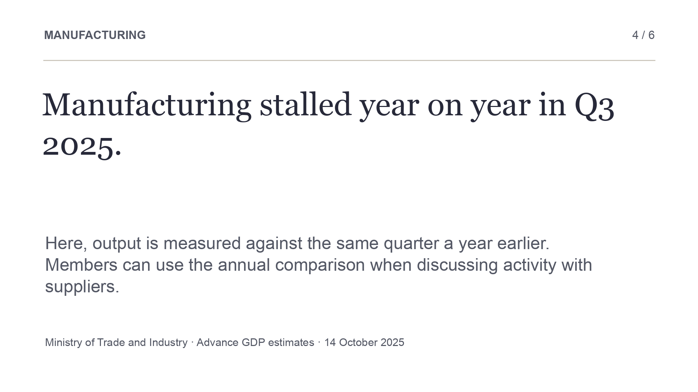
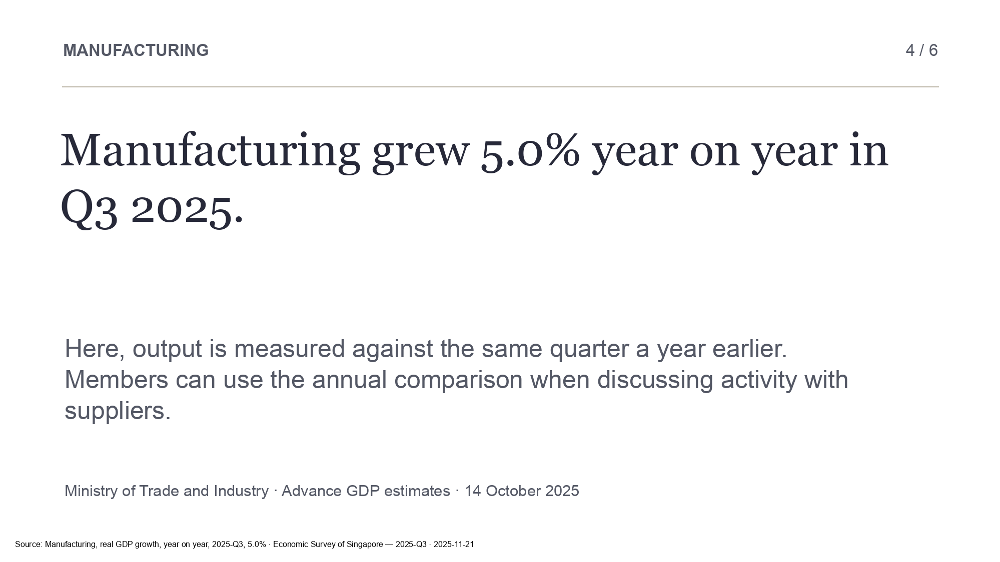

# Recall Press evidence

[Back to Recall Press](../README.md) · [Three-minute judge path](../DEMO.md)

<a href="https://j3jvce39.qwenwork.page/"><strong>Open the live review page</strong></a> · sample run <code>2026-11-21-68013a314ad1</code> · Job 011 review page · Job 001 Desktop session <code>mwq2wb75y5x1adbq</code> · manual live check, 21 Nov at 15:48 SGT

QwenWork × Hashmeta One-Person Company Hackathon, Singapore · Track 1, Business Operations & Automation.

An editor registers a slide or briefing once. When Singapore revises an official figure, Recall Press brings the editor to the exact sentence, with the dated source and the updated PowerPoint, which the editor can still edit. Revisionpedia is its public directory on Hashmeta: one page per figure and quarter, with every archived reading for each covered series and quarter and its source.

## One revision, two answers

On 14 October 2025 the advance estimate put Q3 2025 manufacturing growth at 0.0% year on year. On 21 November 2025 the Economic Survey said: “The manufacturing sector expanded by 5.0 per cent year-on-year” ([MTI release, 21 Nov 2025](https://www.singstat.gov.sg/files/a84a38d1-e0d8-4db9-bcf0-e95696170755.pdf)). The same revision gives two different editorial answers.

| Sentence (sample publications written by the founder) | Verdict after 21 Nov 2025 | What Recall Press does |
|---|---|---|
| Members’ briefing, slide 4: “Manufacturing stalled year on year in Q3 2025.” | **Now wrong.** It describes the quarter as it is now understood. | Proposes “Manufacturing grew 5.0% year on year in Q3 2025.” and the updated PowerPoint with the November source. |
| Board paper: “As first reported in the October advance estimate, manufacturing output was flat year on year in Q3 2025.” | **Still true.** It reports what October’s estimate said. | Leaves it alone. Changing its number would introduce an error. |

<table>
  <tr>
    <td></td>
    <td></td>
  </tr>
  <tr>
    <td>Before. Sample slide, as registered on 20 October 2025.</td>
    <td>After. QwenWork Job 001, replay run <code>2025-11-21-8d43d94969a0</code>. The November source line is added at the foot; the slide’s original October footer is still shown.</td>
  </tr>
</table>

The images reconstruct the PPTX shapes with python-pptx and Pillow. Line wrapping is approximate. The editable file is embedded in [the Job 001 map](qw-results/map-2025-11-21.html).

The [live Revisionpedia record](https://revisionpedia.geo.hashmeta.tech/revisions/sg-gdp-manufacturing-yoy-2025-q3/) shows the full history for that quarter: 0.0% (14 Oct 2025) → 5.0% (21 Nov 2025) → 4.9% (2 Jan 2026) → 5.3% (10 Feb 2026) → 4.6% (14 Apr 2026, unchanged through 14 Oct 2026).

## The problem in public

On 19 November 2026 a claim-specific screen checked 48 public records across 47 URLs that quoted Singapore figures. The screen flagged two: one clear case and one attribution-dependent case. 27 were still true, 18 were not a match and 1 was ambiguous. It is a screen, not a census.

One example: a commercial data platform page, updated 20 October 2026, still gave Singapore’s Q2 2026 GDP growth as 5.9% and called it the latest data. The 14 October 2026 release had revised it to 6.2%. The other case is a news article that attributes an 11.8% construction figure to MTI; the attribution may describe an older statement. The 6 and 57 days in the memo are the gap between revision and the page’s publication or update, not how long a wrong figure stayed up. [Screen memo and data](../qwenwork-out/02-stale-census/stale-census-memo.md)

## What QwenWork does

| Part | What ran | Evidence |
|---|---|---|
| **Skill** | The `recall-press` Skill loaded through the Skill tool in a QwenWork Desktop task (session `mwq2wb75y5x1adbq`, Qwen4-Max, 21 Nov 2026 15:24–15:58 SGT). The instructions specified the expected slide edit. The agent read the members’ briefing, registered its own claim list, replayed 21 Nov 2025, judged each sentence and produced the corrected deck. | [Job 001 report](qw-outbox/001-acceptance-tests/REPORT.md) · [full results](qw-results/RESULTS.md) · [claims](qw-results/claims-members-briefing.json) |
| **First read of an unseen deck** | The agent wrote down 4 verifiable sentences and their verdicts before opening the answer key. All 4 matched. The rules alone found 3. Caveat: the Skill contains a worked example for the zero-growth wording the rules miss, so this is not a test on an unknown customer deck. | [Results, step 3](qw-results/RESULTS.md) · [claims](qw-results/claims-roundtable.json) |
| **Live checks** | Two checks against data.gov.sg (8 series). Check 1, run `2026-11-21-68013a314ad1`, found 2 later revisions for the members’ briefing: services Q1 2025 0.6% → 0.7% (published 10 Feb 2026) and manufacturing Q3 2025 now 4.6% (published 14 Apr 2026). Each draft changes one sentence. On slide 4 the original October footer remains. The replacement cites MTI, Advance GDP estimates, 14 Apr 2026. Both are later readings already published, not a new release that day. It produced 2 corrected drafts. Check 2, run `2026-11-21-98bbcfe8ff96`, was quiet and issued nothing twice. **Both were started manually with Run now after the scheduler missed their slots.** | [clock-1](qw-results/clock-1.md) · [clock-2](qw-results/clock-2.md) |
| **Automatic watch** | The watch was configured for :15 and :45 SGT. The 21 Nov 23:15 slot started automatically at 23:16:37. It checked eight series and was quiet. The 23:45 slot missed. The watch log has one row. The watch checks, logs, stamps and stops. The manual run demonstrated correction delivery. | [Watch log](qw-results/watch-log.md) |
| **Release notice** | The agent matched a pasted release notice to the affected documents and recognised the correction already issued. This was pasted text, not Mail. | [Results, step 5](qw-results/RESULTS.md) · [notice](qw-results/release-notice.txt) |
| **Bridge** | The original bridge claimed Job 002 automatically at 21:10 and missed every slot from 22:10. The replacement missed its 00:05 and 00:35 slots. The owner’s automation now drives QwenWork Desktop to start each job as a Standard-tier task. Job 003 took 13 seconds overall. Its 116 tests took 2.12 seconds. The model was undisclosed. | [Bridge](qw-outbox/BRIDGE.md) · [Job 003](qw-outbox/003-handshake/REPORT.md) |
| **Pitch slides** | Job 009 republished the pitch slides with corrected headlines. | [Pitch slides](https://vtzcv3g2.qwenwork.page/) · [Job 009](qw-outbox/009-deck-honest-headlines/REPORT.md) |
| **PowerPoint download** | Job 005 published the updated PowerPoint from live run `2026-11-21-68013a314ad1`. Slide 4 reads “Manufacturing grew 4.6% year on year in Q3 2025.” | Download the [updated PowerPoint](https://ka62nv48.qwenwork.page/). |
| **Review page** | The review page accepts decisions for one sample run and two claims. Job 011 saved and read back one labelled Apply. A POST with the choice “delete” returned 400. Skip writes and the DELETE method were untested. | Open the [review page](https://j3jvce39.qwenwork.page/). |
| **Fresh deck** | On the first blind read of an independent deck, QwenWork read 8 claims, registered 7 and matched the key on 5/7. [Job 016](qw-outbox/016-fresh-deck-rerun/REPORT.md) rechecked and reused that reading in QwenWork. Rules alone linked 5. With the reading, the fixed engine registered all 8, including the speaker note, and matched all 8 verdicts. | [Briefing](../samples/fresh/chamber-outlook-2026q2.pptx) · [Job 010](qw-outbox/010-fresh-deck-read/REPORT.md) · [Answer key](qw-results/fresh-deck-answer-key.json) |
| **Hashmeta connector** | Job 006 stamped eight indicators using the manual 15:56 check. Job 014 checked those series again and published a fresh stamp on all eight: “Last checked 22 Nov 2026, 00:56 SGT in a live check of the official data by Recall Press on QwenWork: no new revision.” One labelled API enquiry appeared in Hashmeta Forms with its originating record. At that point, browser submission, forwarding, CRM follow-up and organic enquiries were unverified. A later labelled browser submission was stored as submission 2. Job 007 published the pilot offer. | [Live stamp](https://revisionpedia.geo.hashmeta.tech/indicators/sg-gdp-manufacturing-yoy/) · [Job 006](qw-outbox/006-hashmeta-loop/REPORT.md) · [Job 007](qw-outbox/007-hashmeta-cover-copy/REPORT.md) · [Later form check](HASHMETA-LOG.md#22-nov-2026--automation-copy-live) |

Research, screening and media from other QwenWork jobs are in [`qwenwork-out/`](../qwenwork-out/).

## Status at the original demo checks

| Status | What |
|---|---|
| **Real** | Official figures and dated sources. The live [Revisionpedia](https://revisionpedia.geo.hashmeta.tech) on Hashmeta has 77 pages: 5 standalone pages, the Revisions and Indicators lists, 60 revision records and 10 indicator records. The QwenWork runs above, with their run IDs. The [pitch slides](https://vtzcv3g2.qwenwork.page/) published by QwenWork. The [review page](https://j3jvce39.qwenwork.page/) saves editor decisions. On the fresh sample deck QwenWork found all 8 claims, including a table cell and a speaker note. See the fresh-deck row for registration and verdict scores. |
| **Replayed** | The 21 Nov 2025 slide correction uses only figures published by that date. The five local dated maps in [`web/examples/replays/`](../web/examples/replays/) do the same; the last one is a quiet check. |
| **Simulated** | The original briefings and board paper are founder-written samples. The fresh briefing was written independently. The release notice was pasted, not read from Mail. |
| **Manual** | The two one-time live checks were started with Run now after the scheduler missed their slots. |
| **Pending or unverified** | The Job 001 map Page URL. Form forwarding and organiser access to private evidence are unverified. Final submission film pending. No editor has used it on their own briefing; there is no paying customer, and price and demand are unvalidated. |

## Track 1 criteria

| Criterion | Where to look |
|---|---|
| Innovation · 25% | The table above: one revision makes the headline wrong and leaves the dated board-paper sentence true. |
| Feasibility & viability · 25% | Open the updated PowerPoint. Read the [screen of public pages](../qwenwork-out/02-stale-census/stale-census-memo.md) and the [rules test](HARDENING.md): of 40 labelled claims, 28 correct automatic verdicts, 9 left for the agent with a reason, 3 missed. [Pilot offer](submission/first-customer-message.md). |
| Use of QwenWork · 20% | [What QwenWork does](#what-qwenwork-does), with run IDs and reports. |
| Demo · 15% | [DEMO.md](../DEMO.md): public links first, then the local replay. QwenWork generated opening and transition footage. The 50-second draft used local ffmpeg and speech synthesis. The final QwenWork product demo and submission link are pending. |
| Hashmeta website · 15% | The [live directory](https://revisionpedia.geo.hashmeta.tech) and its [build log](HASHMETA-LOG.md). |

The next GDP release is scheduled for **24 November 2026 at 08:00 SGT**, about eight hours after the 23 November 2026 submission deadline. [Release calendar](../data/release-calendar.json)

## Local replay and editor controls

Python 3.10 or later (CI uses 3.14; tested locally on 3.14.7). From a clean checkout:

```sh
python3 -m venv .venv && . .venv/bin/activate && pip install -r requirements-dev.txt && ./demo.sh && python -m pytest -q
```

`./demo.sh` replays the sample publications offline in a fresh workspace and prints paths to the review pages and updated files. Open the review page for 2025-11-21, select the members’ briefing and download the updated PowerPoint. Review page controls: [web/README.md](../web/README.md). Code map: [docs/ARCHITECTURE.md](ARCHITECTURE.md). Skill and task prompts: [skills/recall-press/](../skills/recall-press/SKILL.md).

The editor chooses **Apply fix**, **Skip** or **Edit first**. Edited wording is saved or exported. The download contains the original proposal. Rebuilding with an edit requires a separate local import and rebuild; the editor sends it out. A copy someone already downloaded stays with them.

## Source and library details

Contains SingStat data accessed on 19 November 2026 through data.gov.sg under the [Singapore Open Data Licence v1.0](https://data.gov.sg/open-data-licence). Dated MTI/METI, SingStat and MOM releases establish earlier readings and have their own reuse terms. The refresh reads the licensed API tables. [Dataset IDs, source links and terms](../data/SOURCES.md)

Editable PowerPoint and Word copies use the open-source libraries python-pptx 1.0.2 and python-docx 1.2.0, both MIT licensed. The map renderer uses the Python standard library. [python-pptx](https://pypi.org/project/python-pptx/) · [python-docx](https://pypi.org/project/python-docx/)
