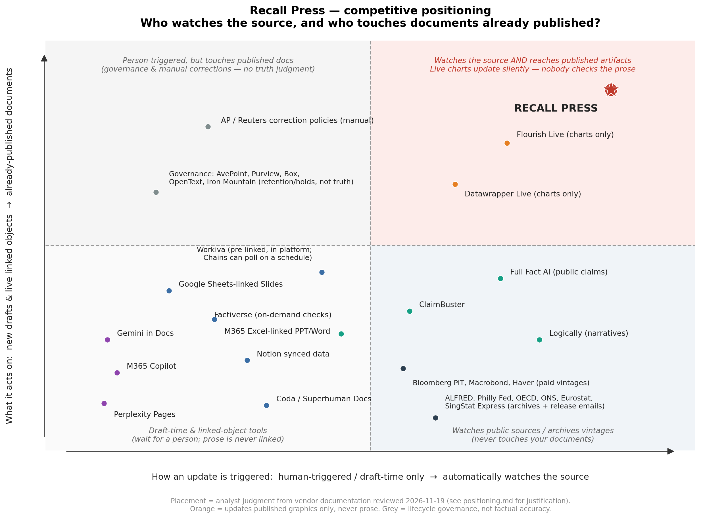

# Recall Press — Positioning (Part C)

**Research date: 2026-11-19.** Placements below are analyst judgment based on the vendor documentation and searches recorded in `competitors.md`; they are not vendor claims. The map is an argument, not a measurement.

---

## The axes, and why these two

**X-axis — How an update is triggered: human-triggered / draft-time only → automatically watches the source.**
This is the axis that separates Recall Press from every writing and linking tool. Copilot, Gemini and Perplexity ground citations *at generation time*; Excel/Sheets links refresh *when a person clicks Update*; Workiva publishes *when a person clicks Publish*. Even the vintage archives (ALFRED, ONS triangles) wait for a researcher to look. The only products that poll a source automatically are Datawrapper/Flourish live charts and the claim monitors (Full Fact, Logically) — and none of them watches *official statistics for revisions*. Recall Press's trigger is the revision event itself.

**Y-axis — What it acts on: new drafts & live linked objects → already-published documents.**
This is the axis that separates Recall Press from every data-linking tool. Linked charts and Workiva destination links live inside *living* files; the moment a deck is exported to PDF, emailed to a board, or filed, the link is dead. Governance tools (Purview, Box, AvePoint) do act on stored/published documents — but only to retain, classify or destroy them, never to check whether their sentences are still true. The only tools that reach into *published* artifacts automatically are Datawrapper/Flourish live embeds — and they update the graphic while leaving the surrounding prose stale, actively *creating* the mismatch Recall Press fixes.

**Why not other axes?** "AI vs not-AI" is uninformative (everyone has AI now). "Price" or "enterprise vs SMB" doesn't capture the functional gap. These two axes map directly onto Recall Press's capabilities 1 (watch) and 2 (find in published docs); capabilities 3 (judge) and 4 (sourced correction + sign-off) are what Recall Press does *inside* the top-right quadrant that even the live-chart tools don't do.

## Quadrant readings

- **Top-right (watches source + reaches published artifacts):** occupied today only by Datawrapper Live and Flourish Live — and only for *charts*. Their auto-updating embeds are the strongest evidence the problem is real: a chart can flip from 0.0% to 5.0% inside a published article while the sentence next to it still says "flat", and neither vendor tells you where the embeds live or what text is now wrong (vendor docs, `competitors.md` §1.4–1.5). Recall Press is the prose-and-judgment layer of this quadrant.
- **Top-left (person-triggered, published docs):** governance/records tools and manual newsroom correction policies. AP's rule — ask subscribers who used the erroneous figure to carry the correction — is exactly Recall Press's distribution workflow, executed by hand (`competitors.md` §3.5).
- **Bottom-left (draft-time / linked objects):** Copilot, Gemini, Perplexity Pages, Office/Google links, Notion, Coda, and Workiva (pre-linked content only; its Chains *can* poll external sources on a schedule, which is why it sits nearest the quadrant boundary).
- **Bottom-right (watches sources / archives vintages, never your documents):** Full Fact, ClaimBuster, Logically, Factiverse (on-demand), and the vintage services — ALFRED, Philadelphia Fed, OECD, ONS, Eurostat, SingStat Express, Bloomberg PiT, Macrobond, Haver. SingStat Express tells you a release happened; it never tells you which of your sentences it breaks.

## "Why hasn't Workiva or Copilot done this?" — three honest sentences

1. **Workiva's linking model assumes content is pre-linked inside its own platform, and its buyers (SEC/ESG filers) pay for pre-filing consistency, not post-filing revision surveillance — but it could ship a "revision watch" easily, because Wdata Chains already polls external sources on a schedule with approval events and email alerts, and its publish-links workflow already is a human sign-off pipeline** (vendor docs: chains overview, link-and-publish; `competitors.md` §1.1).
2. **Copilot and Gemini are draft-time assistants sold per-seat for productivity, and post-publication monitoring requires a persistent index of every published document plus standing source-watchers — a different product shape they haven't built — but Microsoft could assemble it quickly from pieces it already owns (Purview's corpus indexing, web grounding, Copilot agents), which is why this is a feature-risk, not a moat** (no post-publication tracking feature found in targeted searches, 2026-11-19; `competitors.md` §5.1–5.2).
3. **The genuinely hard, genuinely unoccupied part is the semantic judgment — deciding that "manufacturing grew 0.0%" is now wrong while "as first reported in October, manufacturing was flat" is still true — plus multi-agency vintage diffing (SingStat has no public vintage archive or revision-diff alert at all), and that combination is a niche workflow neither vendor has a commercial reason to prioritise today** (`competitors.md` §4.6; `revisions-literature.md` §8).

## The single riskiest competitor: Workiva

**Why Workiva, not Microsoft:** Microsoft has more distribution, but Copilot would ship this as a generic agent feature with no statistical-vintage depth and no correction-audit DNA. Workiva already owns the three hardest adjacent pieces — (1) scheduled external-data pipelines with approval events (Wdata Chains), (2) narrative-text linking with publish/blackline semantics, and (3) enterprise trust in regulated reporting with full audit trails. Adding "watch this official series; when it revises, flag linked and unlinked narrative and route a correction" is a natural extension of its existing platform, and its customers (banks, insurers, public companies) are exactly the board-paper/deck buyers Recall Press targets. Its quote-only enterprise pricing also means it can bundle the feature without a public price signal.

**If Workiva shipped this next month:**
1. **Don't fight on its turf.** Concede pre-linked, in-platform reporting. Recall Press's wedge is the *unlinked, already-published, cross-format corpus* — PDFs, emailed PPTXs, newsletters, CMS articles — that Workiva's workspace-scoped links never reach. Double down on corpus ingestion and sentence-level dependency detection outside any platform.
2. **Own the source layer it doesn't have.** Workiva has no statistical-agency connectors or vintage diffing (unverified/absent in its docs). Ship deep SingStat/MTI, DOSM, BPS, PSA, ONS, BEA, Eurostat coverage with revision-diff semantics ("0.0% → 5.0%, release URL, vintage date") — the thing ALFRED does for economists but nobody does for communicators.
3. **Be the neutral layer across tools.** Workiva-only shops are a subset; most clients live in Office/Google/Canva/CMS. Position Recall Press as source-watch + judgment + correction draft that *hands off* to whatever the client uses (including, eventually, Workiva itself via its API/connectors). Integration beats confrontation for a one-person company.
4. **Move faster on the niche workflow.** The still-true/now-wrong judgment with human sign-off and original-preserved audit trail is the demo that wins the hackathon and the first customers; ship it for newsrooms/comms/IR teams before a platform vendor generalises it.

## Caveats

- Placements are qualitative; e.g. Workiva sits near the X-boundary because Chains *can* be built to poll sources, not because a revision-watch product exists.
- "No feature found" statements are absence-of-evidence from vendor docs and targeted searches on 2026-11-19, not proof of absence; vendors ship quietly.
- Logically has pivoted to narrative intelligence and Perplexity Pages' creation feature is temporarily retired — both placements reflect their current state, not their 2024 marketing.
- The map deliberately shows Datawrapper/Flourish in Recall Press's quadrant: honesty about the nearest neighbours is more credible to judges than an empty quadrant.